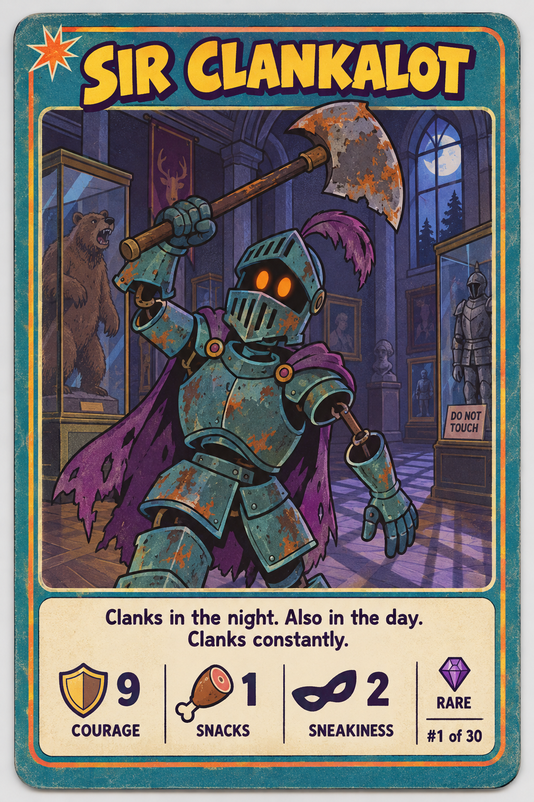

# Trading Cards

A free set of AI-generated trading cards. Use them as test data for your apps, games, demos, and prototypes.



## Sets

| Folder | Set name | Cards | Stats | Rarities |
|---|---|---|---|---|
| [season-1](season-1/) | Spooky Saturday Morning | 30 | Courage, Snacks, Sneakiness | Common (14), Rare (12), Legendary (4) |
| [season-2](season-2/) | Abyssal Oddities | 30 | Glow, Bite, Weirdness | Common (14), Rare (12), Legendary (4) |
| [season-3](season-3/) | Wyrmfall | 30 | Fire, Fury, Scale | Common (14), Rare (12), Legendary (4) |

## What is in a set

Each set folder contains:

- `cards.json` — the set metadata, the image prompts, and one record for each card.
- One PNG for each card (1024 × 1536, portrait).

### `cards.json` shape

```jsonc
{
  "set": {
    "name": "Spooky Saturday Morning",
    "totalCards": 30,
    "statNames": ["Courage", "Snacks", "Sneakiness"],
    "rarities": ["Common", "Rare", "Legendary"]
  },
  "sharedPrompt": {
    "format": "...",      // card format and size
    "artStyle": "...",    // art style used for every card
    "cardLayout": ["..."],// layout rules for the card face
    "negative": "..."     // what the image must not contain
  },
  "cards": [
    {
      "id": "sir-clankalot",
      "name": "Sir Clankalot",
      "cardNumber": 1,
      "rarity": "Rare",
      "character": "...",
      "poseAndExpression": "...",
      "backgroundScene": "...",
      "flavourText": "Clanks in the night. Also in the day. Clanks constantly.",
      "stats": { "Courage": 9, "Snacks": 1, "Sneakiness": 2 },
      "image": "./sir-clankalot.png"
    }
  ]
}
```

The `image` path is relative to `cards.json`. The prompt fields let you make more cards in the same style. See [PROMPTS.md](PROMPTS.md) to learn how to build a full image prompt from a card.

## Ideas

- Seed data for a card game, deck builder, or collection tracker.
- Sample content for UI components: grids, carousels, detail pages, search, and filters.
- Fixtures for tests that need images with structured data.
- Input for image, OCR, or classification experiments.

## License

All cards, images, and data are released under [CC0 1.0](https://creativecommons.org/publicdomain/zero/1.0/). You can copy, change, and use them for any purpose, including commercial use. Attribution is not required.

The images were made with AI. The characters are original and are not based on existing cartoon characters.
