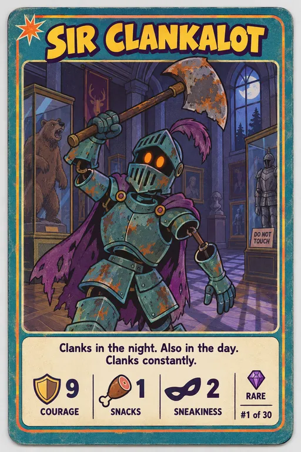
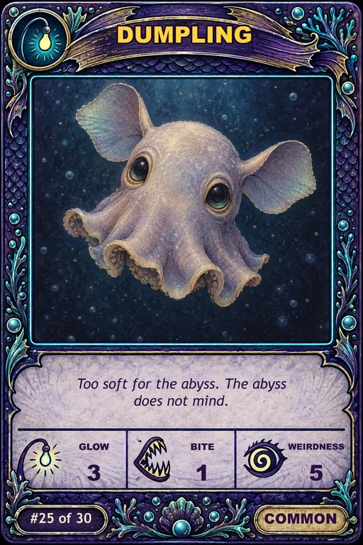
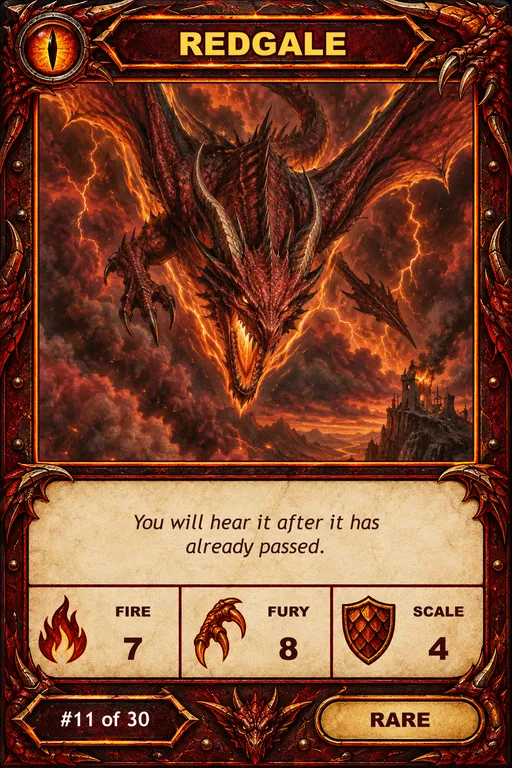
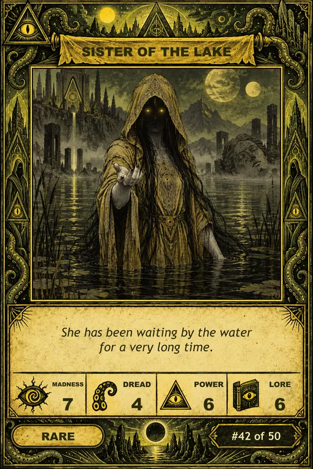

# Trading Cards

A free set of AI-generated trading cards. Use them as test data for your apps, games, demos, and prototypes.







## Sets

| Folder | Set name | Cards | Stats | Rarities |
|---|---|---|---|---|
| [season-1](season-1/) | Spooky Saturday Morning | 30 | Courage, Snacks, Sneakiness | Common (14), Rare (12), Legendary (4) |
| [season-2](season-2/) | Abyssal Oddities | 30 | Glow, Bite, Weirdness | Common (14), Rare (12), Legendary (4) |
| [season-3](season-3/) | Wyrmfall | 30 | Fire, Fury, Scale | Common (14), Rare (12), Legendary (4) |
| [season-4](season-4/) | Carcosa Rising | 50 | Madness, Dread, Power, Lore | Common (23), Rare (20), Legendary (7) |

## How the cards were made

| Script | Made | How | Docs |
|---|---|---|---|
| `v1-generate-cards.ts` | Season 1 | Each card is one complete image, so the frame is a little different on every card. | [docs/v1-generate-cards.md](docs/v1-generate-cards.md) |
| `v2-compose-cards.ts` | Seasons 2 to 4 | One shared frame, with each card's art and text added to it, so every card in a set has the same frame. | [docs/v2-compose-cards.md](docs/v2-compose-cards.md) |

Both scripts make their images with [OpenRouter](https://openrouter.ai/), so they need an `OPENROUTER_API_KEY`. You can use a different image generator: only the `generate` function in each script calls OpenRouter, so that is the only part to change. The prompts in `cards.json` work with any image generator.

`make-small-cards.ts` makes the small copies of the cards. It does not need OpenRouter. For each card, it makes a WebP image 512 pixels wide next to the full-size image, and writes its path to `imageSmall` in `cards.json`. Give it one or more `cards.json` files:

```sh
node make-small-cards.ts season-4/cards.json
```

## What is in a set

Each set folder contains:

- `cards.json` — the set metadata, the image prompts, and one record for each card.
- `cards/` — one PNG for each card (1024 × 1536, portrait).
- One small WebP for each card (512 × 768), next to its PNG, for grids and thumbnails.
- Seasons 2 to 4 only: `frame.png` (the shared empty frame) and `art/` (the art for each card, without the frame).

### `cards.json` shape

```jsonc
{
  "set": {
    "name": "Spooky Saturday Morning",
    "totalCards": 30,
    "statNames": ["Courage", "Snacks", "Sneakiness"],
    "rarities": ["Common", "Rare", "Legendary"]
  },
  "sharedPrompt": {
    "format": "...",      // card format and size
    "artStyle": "...",    // art style used for every card
    "cardLayout": ["..."],// layout rules for the card face
    "negative": "..."     // what the image must not contain
  },
  "cards": [
    {
      "id": "sir-clankalot",
      "name": "Sir Clankalot",
      "cardNumber": 1,
      "rarity": "Rare",
      "character": "...",
      "poseAndExpression": "...",
      "backgroundScene": "...",
      "flavourText": "Clanks in the night. Also in the day. Clanks constantly.",
      "stats": { "Courage": 9, "Snacks": 1, "Sneakiness": 2 },
      "image": "./cards/sir-clankalot.png",
      "imageSmall": "./cards/sir-clankalot-small.webp"
    }
  ]
}
```

The `image` and `imageSmall` paths are relative to `cards.json`. The prompt fields let you make more cards in the same style. See [PROMPTS.md](PROMPTS.md) to learn how to build a full image prompt from a card.

## Ideas

- Seed data for a card game, deck builder, or collection tracker.
- Sample content for UI components: grids, carousels, detail pages, search, and filters.
- Fixtures for tests that need images with structured data.
- Input for image, OCR, or classification experiments.

## License

All cards, images, and data are released under [CC0 1.0](https://creativecommons.org/publicdomain/zero/1.0/). You can copy, change, and use them for any purpose, including commercial use. Attribution is not required.

The images were made with AI. The characters are original and are not based on existing cartoon characters.
